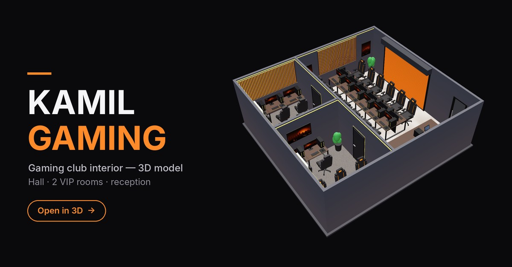

# KAMIL GAMING — 3D Interior

Interactive 3D model of the KAMIL GAMING club: a 12-seat main hall, two 5-seat VIP rooms and the reception area.

**▶ Open the 3D viewer:** https://aarashev.github.io/kamil-gaming-3d/

In the viewer you can drag to rotate, scroll or pinch to zoom, switch the ceiling on and off, and jump to a top-down plan view.

The model file is [`kamil-gaming-3d.glb`](kamil-gaming-3d.glb) (glTF binary). It opens in Blender, Windows 3D Viewer, or any glTF viewer.
